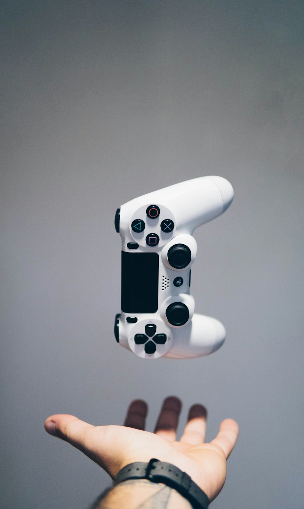

# ASCII Studio Ultra-HD

초고밀도 컬러 아스키 아트 & 곡률 보정 정지 이미지 전용 스튜디오 웹 애플리케이션입니다.



## 주요 기능 (Key Features)

1. **4가지 렌더링 모드 (4 Rendering Modes)**
   - **Curvature / Edge-Aware ASCII**: $3 \times 3$ 소벨 필터(Sobel Filter)로 인접 픽셀의 기울기와 각도를 계산해, 윤곽선(곡선) 부분에는 선의 방향에 맞는 문자(`/`, `\`, `|`, `-`, `(`, `)`)를 배치하여 곡률 정교하게 표현
   - **Ultra-Fine Braille (점자 모드)**: 유니코드 점자 블록(`U+2800` ~ `U+28FF`) 8개 비트매핑을 활용해 문자 1칸당 $2 \times 4$ 서브픽셀을 샘플링함으로써 실질 해상도를 8배로 극대화
   - **True-Color Half-Block**: 하프 블록 문자(`▀`, `U+2580`)를 사용해 위쪽 색상은 전경색(`fillStyle`), 아래쪽 색상은 배경색(`fillRect`)으로 칠해 검은 빈틈 없이 원본 사진 색조 100% 복원
   - **Classic ASCII**: ITU-R BT.709 지각 밝기(Luminance)를 밀도별 문자열(`@%#*+=-:. `)에 정밀 매핑

2. **단일 HTML5 Canvas 고성능 렌더링**
   - 수만 개의 DOM 요소 대신 단일 `<canvas>`에 직접 렌더링하여 부드러운 반응성 확보
   - 고정폭 폰트의 세로 길쭉함 왜곡을 보정하기 위한 세로 비율 보정($\text{stepY} \approx \text{stepX} \times 1.9$) 적용

3. **인터랙티브 뷰어 (Interactive Viewer)**
   - **Before / After 스플릿 슬라이더**: 원본 사진과 아스키 결과물을 좌우로 실시간 드래그 비교
   - **Zoom & Pan**: 마우스 휠 무단 확대/축소 (0.08x ~ 15x) 및 드래그 이동, 원클릭 Fit 화면 맞춤
   - **실시간 통계 HUD**: 현재 칸 수, 글자 수, 렌더링 소요 시간(ms) 표시

4. **정밀 컨트롤 & 팔레트**
   - **해상도 조절**: 60칸 ~ 최대 400칸(초고밀도 모드)
   - **이미지 보정**: 밝기(Brightness), 대비(Contrast), 채도(Saturation)
   - **컬러 팔레트 5종**: Original Color, Matrix Green, Cyberpunk Neon, Monochrome, Invert Color
   - **배경색 전환**: 순수 블랙(`#000000`) / 다크 그레이(`#111318`)

5. **내보내기 (Export)**
   - **Download PNG**: 1x 표준 고해상도 / 2x 초고화질 (Ultra-HD) 선택 저장
   - **Copy Text**: Classic, Edge, Braille 모드 순수 텍스트 클립보드 원클릭 복사

---

## 기술 스택 (Tech Stack)

- **Frontend**: React 18, TypeScript, Tailwind CSS, Lucide React
- **Build Tool**: Vite
- **Deployment**: Netlify 정적 배포 지원 (`public/_redirects` 포함)

---

## 실행 방법 (Getting Started)

### 설치 및 로컬 실행

```bash
# 의존성 패키지 설치
npm install

# 로컬 개발 서버 실행
npm run dev
```

브라우저에서 `http://localhost:5173`으로 접속합니다.

### 프로덕션 빌드

```bash
npm run build
```

빌드 결과물은 `dist/` 디렉터리에 생성됩니다.
